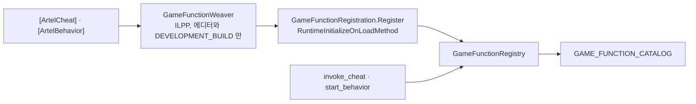

# ADR 0007 — 게임이 등록한 cheat 와 behavior 를 부르는 action 네 개를 ADR 0002 의 예외로 둔다

- 상태: 확정
- 고치는 것: [ADR 0002](0002-action-vocabulary.md)
- 근거: `Packages/kr.artel.sdk/Runtime/GameFunctions/`, `Packages/kr.artel.sdk/Editor/CodeGen/GameFunctionWeaver.cs`,
  `.plan/general/2026-10-14-game-registered-cheats-and-behaviors-in-the-sdk.md`, 워크스페이스의
  `.plan/general/2026-10-14-game-functions-wire-contract.md` (ARTEL-1051)

## 결정

- action 어휘에 `invoke_cheat`, `start_behavior`, `stop_behavior`, `extend_behavior` 네 개를 더합니다.
- 네 action 의 뜻은 SDK 가 아니라 게임이 정합니다. 게임 개발자가 메서드에 `[ArtelCheat]` 나
  `[ArtelBehavior]` 를 달고, action 은 그 이름과 인자를 나를 뿐입니다.
- SDK 는 여전히 게임의 뜻을 담은 action 을 하나도 정의하지 않습니다. `give_gold` 나 `auto_attack` 은 SDK
  계약에 없고, 게임마다 다른 목록은 `GAME_FUNCTION_CATALOG` frame 으로 실행 중에 알립니다.
- 출시 빌드에서는 네 action 모두 거절합니다(`cheats are not available in this build`,
  `behaviors are not available in this build`). 등록 코드는 에디터와 `DEVELOPMENT_BUILD` 에서만 만들어집니다.

| 무엇 | 하는 일 |
| --- | --- |
| cheat | 한 번 돌고 결과를 돌려줍니다. test case 의 전제 조건에 빨리 닿기 위한 것입니다 |
| behavior | `stop_behavior` 나 다른 끝날 이유가 올 때까지 프레임마다 돕니다. agent 의 한 턴보다 빠른 입력이 필요한 실시간 게임을 위한 것입니다 |

## 왜

- ADR 0002 가 게임의 뜻을 담은 action 을 막은 이유는 SDK 계약이 게임 수만큼 늘어나는 것이었습니다. 이름을
  payload 에 싣는 범용 action 한 벌은 계약을 고정한 채 게임마다 다른 함수를 부를 수 있게 합니다.
- agent 가 사람처럼 플레이해서만 전제 조건에 닿으면, test case 하나에 tool 호출 수십 번이 들고
  `SETUP-FAILED:` 로 끝나는 일이 많습니다. cheat 는 그 앞부분을 게임 코드 한 번으로 줄입니다.
- 실시간 게임은 프레임마다 입력을 기대하는데 agent 의 한 턴은 몇 초입니다. behavior 는 프레임마다 할 일을 게임
  코드에 맡기고, 언제 싸우고 언제 멈출지는 agent 에게 남깁니다.

## 만드는 방식

- 등록은 빌드 때 만듭니다. `GameFunctionWeaver` 가 attribute 가 달린 메서드를 찾아, 그 메서드를 직접 부르는
  stub 과 등록 코드를 씁니다. 런타임에 reflection 으로 어셈블리를 훑지 않고, 만들어진 코드가 메서드를 참조하므로
  managed stripping 이 지우지 않습니다.
- 받을 수 없는 parameter 타입, 같은 이름, 없는 `when` 메서드는 컴파일 오류입니다. run 중에 처음 알게 되면 고칠
  사람이 그 자리에 없습니다.
- behavior 는 SDK 가 iterator 를 직접 `MoveNext()` 하고 끝날 때 `Dispose()` 합니다. `StopCoroutine` 은 `finally`
  를 돌리지 않기 때문입니다. 시간은 `Time.deltaTime` 으로 재므로 `pause_time` 이 behavior 도 멈춥니다.
- 데이터에서 만드는 cheat 는 `ArtelCheats.Register` 로 실행 중에 더합니다. 같은 registry 에 들어갑니다.

## 거절한 대안

| 대안 | 왜 거절했나 |
| --- | --- |
| 게임마다 `give_gold` 같은 action 을 SDK 에 더함 | ADR 0002 가 막은 바로 그것. 계약이 게임 수만큼 늘어남 |
| 시작할 때 reflection 으로 attribute 를 찾음 | 시작마다 어셈블리를 훑는 값이 들고, stripping 을 피하려면 `link.xml` 이나 `[Preserve]` 가 필요함 |
| `[ArtelAction]` weaver 를 다시 씀 | 그 weaver 는 호출을 기록할 뿐 부르지 못하고, ARTEL-429 에서 없어질 수 있음 |
| behavior 를 `StartCoroutine` 으로 돌림 | `StopCoroutine` 이 `finally` 를 돌리지 않아 개발자의 정리 코드가 빠짐 |

## 대가

| 대가 | 무엇이 일어나나 |
| --- | --- |
| cheat 가 진짜 버그를 가릴 수 있음 | 검증할 값을 cheat 가 만들면 틀린 기대가 통과함. agent-server 의 `used_cheats` 기록과 test case 의 `functions` 허용 목록으로 드러냄 |
| behavior 는 입력 계층을 건너뜀 | 조작 자체를 검증하는 step 에는 behavior 를 쓰지 않아야 함. agent 쪽 규칙으로 막음 |
| `WaitForSeconds` 의 초를 private field 로 읽음 | Unity 가 그 값을 공개하지 않음. field 를 못 찾는 버전이면 한 프레임으로 치고 경고를 남김 |
| 활성 씬 밖 객체의 `selector` 는 `ScenePathSelectorResolver` 가 풀지 못함 | SDK 가 내준 `selector` 는 살아 있는 instance 목록과 먼저 맞춰 보므로 그대로 돌아옴 |
